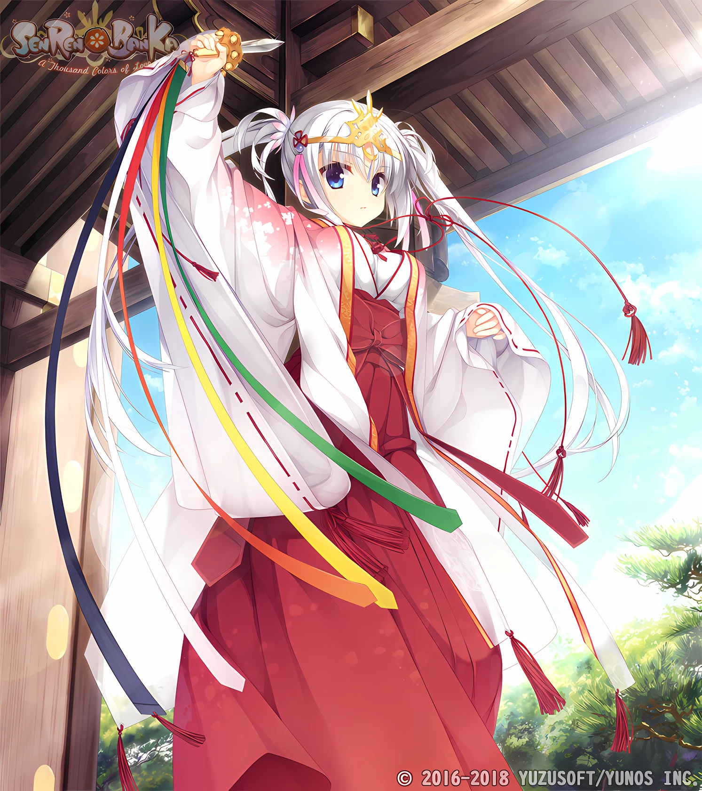
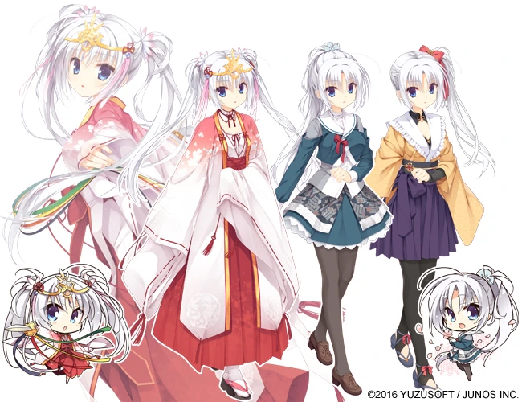
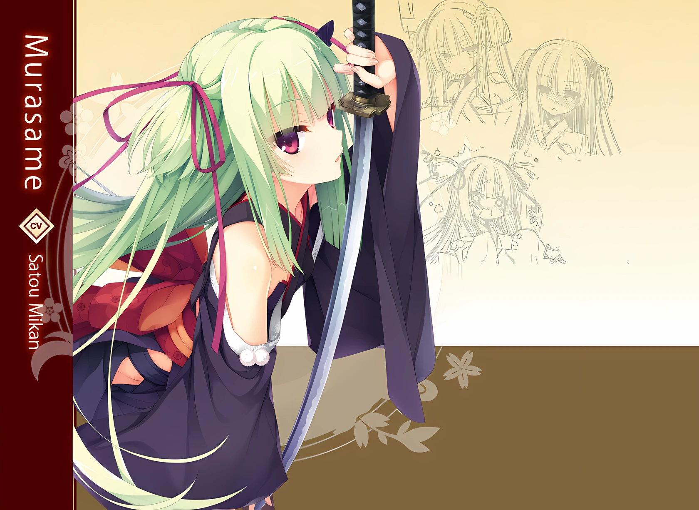
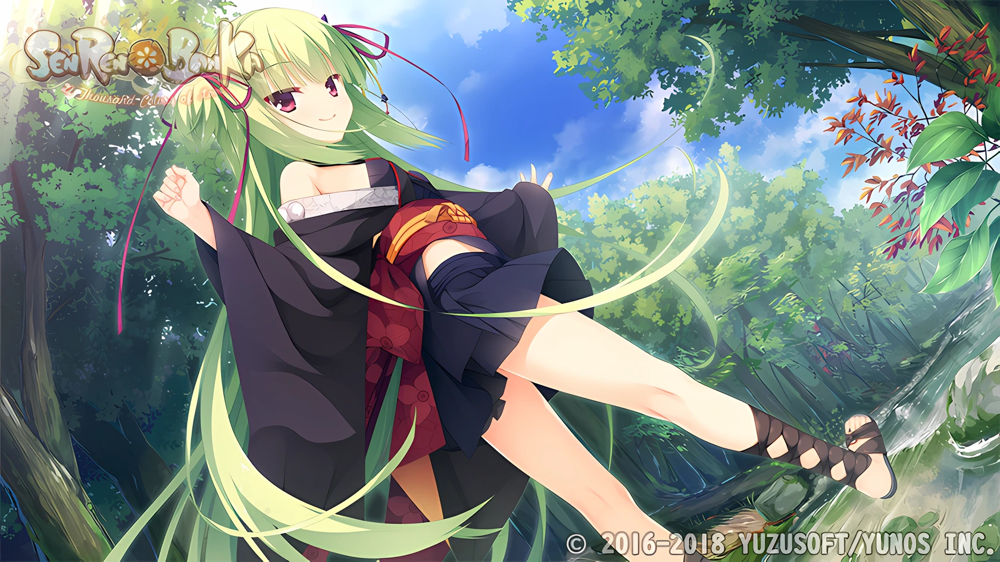

  

<h2 align="center">玉树樱 · 初雪樱</h2>

   
  黑板的相合伞下，写着「はつゆき」和「さくら」。

<table width="100%">
  <tr>
    <td width="54%" align="center" valign="top">
       
      课桌上，两个小雪人共撑一把伞。
    </td>
    <td width="46%" align="center" valign="top">
       
      「初雪から桜まで　卒業おめでとう」
    </td>
  </tr>
</table>

<table width="100%">
  <tr>
    <td width="50%" align="center" valign="top">
       
      樱递来一勺草莓甜点。
    </td>
    <td width="50%" align="center" valign="top">
       
      「キッスタイムではないでしょうか」
    </td>
  </tr>
</table>

<table width="100%">
  <tr>
    <td width="50%" align="center" valign="top">
       
      「MERRY CHRISTMAS!」
    </td>
    <td width="50%" align="center" valign="top">
       
      白熊「シロクマ、シロクマ男歌いまーすっ」
    </td>
  </tr>
</table>

<table width="100%">
  <tr>
    <td width="32%" align="center" valign="top">
       
      演出服、星光和一个Wink。
    </td>
    <td width="68%" align="center" valign="top">
       
      菠萝、扶桑花和夏日装扮。
    </td>
  </tr>
</table>

   
  樱和总陪在她身边的兔子ネム。

<h2 align="center">朝武芳乃 · 千恋＊万花</h2>

<table width="100%">
  <tr>
    <td width="43%" align="center" valign="top">
       
      神社檐下，芳乃举刀起舞。
    </td>
    <td width="57%" align="center" valign="top">
       
      「穗织当地神社的巫女。」
    </td>
  </tr>
</table>

<table width="100%">
  <tr>
    <td width="51%" align="center" valign="top">
       
      朝武芳乃（CV 遥そら），巫女服与表情草图。
    </td>
    <td width="49%" align="center" valign="top">
       
      芳乃的巫女服、校服与和装。
    </td>
  </tr>
</table>

<table width="100%">
  <tr>
    <td width="47%" align="center" valign="top">
       
      「芳乃描きおろし壁紙」
    </td>
    <td width="53%" align="center" valign="top">
       
      夕阳下，芳乃回眸，手还牵着。
    </td>
  </tr>
</table>

<table width="100%">
  <tr>
    <td width="50%" align="center" valign="top">
       
      穿着粉色浴衣的芳乃，兽耳露出来了。
    </td>
    <td width="50%" align="center" valign="top">
       
      同一身粉色浴衣，芳乃露出浅笑。
    </td>
  </tr>
</table>

<h2 align="center">丛雨 · 千恋＊万花</h2>

   
  「神刀“丛雨丸”的管理者。」

<table width="100%">
  <tr>
    <td width="50%" align="center" valign="top">
       
      树影与溪水间，丛雨踏着凉鞋。
    </td>
    <td width="50%" align="center" valign="top">
       
      换上校服的丛雨，牵着手往前跑。
    </td>
  </tr>
</table>
